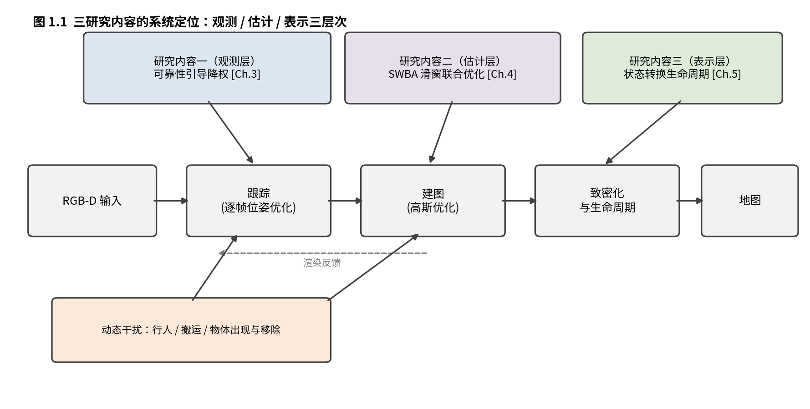

# Chapter 1 绪论（草稿）

> 状态：骨架。定稿依赖综述（Ch.2）与三研究内容（Ch.3/4/5）成型。

## 1.1 研究背景与意义

### 1.1.1 实时稠密 SLAM 的应用牵引

自主系统领域把增强现实、机器人与自动驾驶并列为 SLAM 的三大
推进力 [@wang2024dynamicsurvey]——这一归类不是偶然：三者对定位
与建图的要求高度重叠，又都把"环境中有人在动"当作常态而非例外。
逐一看它们对 SLAM 的具体要求，可以精确刻画本文要补的缺口。

**增强现实**：AR 的定义性要求是把虚拟内容与真实世界在时空上对齐
[@azuma1997ar]——对齐错了，虚拟物体"漂"在环境上，沉浸感与任务
价值同时失效。对齐的载荷完全压在设备自定位（跟踪）上，而跟踪
质量的上限由地图决定：行人从镜头前走过、家具被挪动、门扇开合，
静态地图与真实场景的偏差直接转化为注册误差。更进一步的虚实
遮挡（虚拟物体被真实行人正确遮挡）要求地图不但稠密可渲染，
还要知道**哪些几何此刻可信**——这已经是动态内容管理问题，不是
定位问题。移动/头戴平台的算力约束又排除了"离线重建"的退路。

**移动机器人与自主导航**：机器人需要稠密地图做避障与操作规划，
而其工作场景（仓库、商场、家庭）恰恰是人机共享的高动态环境。
动态环境综述把"运动物体引入的几何不一致"列为视觉 SLAM 的
主要误差源之一，并将处理它视为从实验室走向真实部署的分水岭
[@saputra2018survey]——被行人污染的特征关联轻则放大定位噪声，
重则把行人几何固化进地图、沿错误的地图规划出穿过人身的路径。
导航安全的底线要求地图持续反映"世界现在的样子"，即地图基元
要有生命周期，而非一次构建永久有效。

**数字孪生与内容创建**：从单段视频重建可编辑的场景模型，表示
必须显式且可操作——补一个静态点云无法支持重光照与增删，隐式
神经场编辑代价高。显式基元表示（3DGS）在这个链条上的价值是
"可编辑性"：插入、更新、删除都以基元为单位进行。

这三类应用的共同要求——实时、稠密、可渲染、可编辑、**随动态
内容在线更新**——超出了传统稀疏特征点 SLAM（ORB-SLAM 系）的
服务范围：其地图是稀疏路标，既不支撑渲染，也无基元级的编辑面。
NeRF 与 3DGS 为表示的稠密视觉 SLAM 正是在这个缺口上起来的，
而"随动态内容在线更新"这一条是其中最新、也是本文的主战场。

### 1.1.2 动态场景：从工程便利到部署刚需

实验室场景默认静态世界假设；真实部署环境（家庭、商场、街道）
充满行人、搬运、门扇、宠物。静态假设被违反的代价不是精度下降
而是量级崩溃：本文基座在动态基准上漂移 39-147cm，静态场景仅
约 1.5cm（Ch.3 开篇实测）。动态内容处理因此不是 SLAM 的锦上添花，
而是从实验室到部署的第一道门槛——其质量直接决定定位精度与
地图可用性，也决定下游任务（AR 注册、导航安全）的成败。

### 1.1.3 为什么是 3DGS 与单目

**3DGS 的结构性优势**：显式高斯基元支持实时光栅化渲染（跟踪损失
的直接作用面）与逐基元编辑（插入/剪枝/生命周期管理）——为"动态
内容的在线增删"提供了 NeRF 隐式表示不具备的操作面（Ch.2.2 详述）。
**单目设置的定位**：最普适（单摄像头，无深度传感器依赖）也最难
（深度尺度不定，动态与尺度耦合）；本文实验主线在 RGB-D 基座上
建立机制（隔离尺度变量），单目扩展作为展望（Ch.6）。

## 1.2 国内外研究现状（缩略版，详见 Chapter 2）

动态 3DGS-SLAM 的研究现状可概括为"两线三空缺"：

**anti-dynamic 路线**（把动态当干扰移除/降权）：语义先验档以
WildGS-SLAM（CVPR 2025，Bonn 2.31cm）为代表，依赖 DINOv2 级
预训练特征；免语义档（Dy3DGS-SLAM、GGD-SLAM 等）以光流/几何
一致性判别，精度普遍落后一档——**G1：免类别先验且具竞争精度
的动态判别仍空缺**。**face-dynamic 路线**（显式建模动态，4D/
变形场）：单目设置下实时性与深度尺度均未解决。**地图管理**：
MoPe/DL-SLAM 等开始触及生命周期，但在线状态转换场景不完整
——**G3：提交后基元的退出/恢复机制空缺**。**跟踪后端**：
优化式方法以逐帧光度优化为主流（MonoGS 系），学习式以 DROID
类稠密 BA 为主流（Bonn 2-8cm 档全部在此）；前者长期漂移无内解
——**G5：跟踪循环内的窗口约束空缺**。

国内方面，3DGS-SLAM 研究活跃于高校与工业实验室（DG-SLAM、
RoDyn-SLAM 等），动态场景处理同样以上述两条路线为主。本文
三个研究内容分别对应 G1/G5/G3（详见 Ch.2 综述）。

## 1.3 本文研究内容（三内容 = 观测/估计/表示三层次）

动态 3DGS-SLAM 的鲁棒性可分解为三个正交层次：**观测层**（哪些
像素可信）、**估计层**（位姿链如何保持一致）、**表示层**（地图
基元如何随场景演化）。本文按此三层组织三个研究内容：

**研究内容一（观测层）：免类别先验的可靠性引导动态跟踪（RoGS-SLAM）**
以光流一致性构造逐像素静态置信，有下界降权替代移除；配四组件
系统（均匀关键帧覆盖 / Huber IRLS / 可靠性信号 / lineage 生命
周期）→ 填补空缺 G1/G3 前半。成果：MMM 2027 投稿（已收口，
Ch.3）。

**研究内容二（估计层）：跟踪循环内的在线滑窗光度联合优化（SWBA）**
以后处理四象限失败的系统证据（边类型×跨度全否决）论证漂移的
"事后不可修复性"，进而把窗口光度约束嵌入跟踪循环、修正即时
回灌 → 填补空缺 G5。person_tracking 13.62±3.27→7.83±0.51cm
（−42%，两层架构叠加逐帧部署门控，3-seed 确认）。小论文 2
目标（Ch.4）。

**研究内容三（表示层）：场景状态转换下的可信度驱动高斯生命周期**
（pilot 判决立项；正式研究将主张修正为地图维护端：残影清理在
2/3 序列成立、填充保守化臂改善最强，跟踪端增益未复现而撤回）
已提交基元在物体移走/遮挡消失/背景重现等状态转换下的退出、
恢复与补全——Ch.3 lineage 的后半程，填补空缺 G3 后半。（Ch.5）

三层次的系统性：观测层的残存失效（pt1 家族）恰是估计层的入口
问题；估计层的稳定位姿又是表示层生命周期判别的可信基准——
层层递进。致密化（原候选方向）降级为内容三内部的可选动作/消融项
（Phase 1 已止损的证据不支撑独立成章）。

图 1.1：三研究内容在动态 3DGS-SLAM 流水线中的三层定位
（答辩版可再美化，见 FIGURE_SPECS.md）。

## 1.4 论文组织结构

- 第 1 章 绪论：背景意义、研究现状缩略、三研究内容与关系、结构
- 第 2 章 相关理论与技术基础：SLAM 范式演进、3DGS 与 3DGS-SLAM、
  动态处理两路线、高斯表示与在线地图管理
- 第 3 章 研究内容一（观测层）：RoGS-SLAM 免类别先验的可靠性
  引导动态跟踪
- 第 4 章 研究内容二（估计层）：SWBA 在线滑窗光度联合优化
- 第 5 章 研究内容三（表示层）：场景状态转换下的可信度驱动高斯
  生命周期
- 第 6 章 总结与展望

附录/攻读期间成果按学校模板要求（济南大学 2026 理工类模板）。

---
**TODO**：
- [x] 1.1.1 扩写（AR/机器人/数字孪生三应用逐项展开，引用带立场；azuma1997ar/saputra2018survey/wang2024dynamicsurvey 核实入 bib，2026-09-12）
- [ ] 总架构图（三内容定位图，论文第一图）
- [ ] 与开题报告表述对齐（学硕三内容框架已在开题确认）
