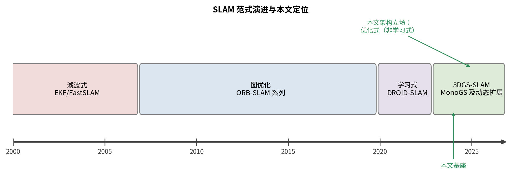

# 2.1 SLAM 范式演进（综述草稿）

> 状态：草稿完成。经典文献 bib 已补（2026-09-12）。

## 2.1.1 问题定义

SLAM（同时定位与建图）在未知环境中联立估计相机位姿序列与场景模型。
视觉 SLAM 以图像为唯一/主要观测，其核心张力：位姿估计需要可靠场景
模型，模型构建又需要准确位姿——两者在线交替（tracking / mapping）。

## 2.1.2 三个范式

**滤波式**（2000s，EKF-SLAM 系列）：以扩展卡尔曼滤波联立维护位姿
与路标的后验分布，单目实例以 MonoSLAM [@davison2003monoslam] 为
起点——首次把稀疏自然特征地图装进实时单相机。理论优雅但有两个
结构性限制：计算与内存随路标数平方增长；线性化误差在长序列累积。
粒子滤波（FastSLAM 系 [@fastslam2002]）用路标条件独立假设把后验
分解，缓解了前者但引入粒子退化问题。该范式的遗产是概率图模型的
语言，被图优化范式继承。

**基于图优化**（2010s 主导）：关键帧 + 因子图，前端特征关联、后端
批量非线性优化（g2o/Ceres）。ORB-SLAM [@orbslam2015] 把单目稀疏
特征 SLAM 做到通用且精确，ORB-SLAM2 [@orbslam2_2017] 补齐双目/
RGB-D 与完整回环，ORB-SLAM3 [@orbslam3_2021] 再引入多地图与视觉-
惯导紧耦合——三者共同确立关键帧图优化的工程范式。地图仍是稀疏
路标，渲染与稠密几何非其目标。

**学习式**（2020s）：DROID-SLAM [@droid2021] 以 GRU 迭代更新稠密 BA
层的位姿-深度联合估计，鲁棒性与精度大幅提升，但依赖大规模训练数据，
泛化与算力是代价。本文架构立场：优化式（非学习式）主干 + 几何/运动
一致性信号，在动态场景这一特定困难上逼近学习式精度（Chapter 3/4
核心主张的实验支撑）。

## 2.1.3 面向稠密渲染的表示演进（引向 2.2）

稠密地图表示从点云→TSDF→神经隐式（NeRF 系）→显式高斯
（3DGS [@kerbl3dgs2023]）。SLAM 与表示的耦合点：跟踪损失直接作用于
表示的渲染（光度直接法），表示的可微性与渲染速度决定跟踪上限。
该线索引出 2.2 节的 3DGS-SLAM。

---
**TODO**：
- [x] ORB-SLAM 系 bib（orbslam2015/orbslam2_2017）+ EKF 时代引用（davison2003monoslam）+ FastSLAM（fastslam2002）——2026-09-12 核实入 references.bib

图 2.1：SLAM 范式时间线与本文架构立场。- [x] 时间线图已渲染
