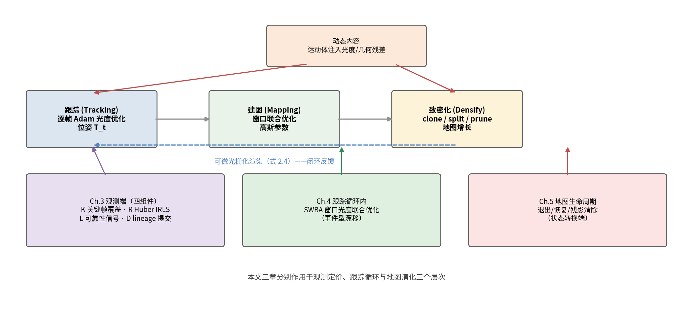

# 2.2 3D Gaussian Splatting 与 3DGS-SLAM（综述草稿）

> 状态：骨架 + 首段。3DGS 原文、MonoGS、DROID-SLAM（BA 层对照）已核实入 bib。

## 2.2.1 3D Gaussian Splatting 表示

3DGS [@kerbl3dgs2023] 以各向异性 3D 高斯基元集合显式表示场景，通过
可微光栅化实现实时（≥100 FPS）高保真新视角合成。每个基元由中心
位置 μ∈R³、协方差 Σ、不透明度 α 与球谐系数（视角相关颜色）参数化，
其空间密度为

    G_i(x) = exp(−½ (x − μ_i)ᵀ Σ_i⁻¹ (x − μ_i))    (2.1)

协方差必须保持半正定，直接优化 Σ 的六个分量无法保证这一点，故 3DGS
不做自由优化，而是将其分解为旋转与缩放：

    Σ_i = R_i S_i S_iᵀ R_iᵀ，  S_i = diag(s_x, s_y, s_z)    (2.2)

R_i 由单位四元数给出。这一分解的意义不止于数值合法性：它把"细长
椭球"变成可优化对象，而各向异性正是 3DGS 在同等基元数下优于各向
同性点基元的原因——沿表面切向拉长、沿法向压扁，单个基元即可贴合
一个局部平面片。

渲染时基元需投影到像平面。严格来说，3D 高斯经透视投影后的分布不再
是高斯，3DGS 沿用 EWA splatting 的做法，在基元中心处对投影变换做
一阶（仿射）展开：

    Σ'_i = J_i W Σ_i Wᵀ J_iᵀ    (2.3)

W 为世界到相机的变换，J 为投影变换在该点的雅可比。这一步是近似：
基元张角较大或远离光心时，屏幕空间分布与真实投影的偏差增大。3DGS
用分裂与克隆把基元维持在局部尺度以抑制该误差，代价是基元数持续
增长——本文 Ch.5 的地图生命周期管理正源于这一代价。

投影后按深度排序，逐像素做 α-blending：

    C(u) = Σ_i c_i · α_i · Π_{j<i} (1 − α_j)    (2.4)

其中 c_i 为球谐系数在视线方向的求值，α_i = o_i · exp(−½ (u − μ'_i)ᵀ
Σ'_i⁻¹ (u − μ'_i))，o_i 为基元不透明度，μ'_i 为其屏幕空间中心。
相比 NeRF 的隐式表示，高斯基元的显式性带来三个 SLAM 关键优势：任意
视角的快速渲染（支撑逐帧光度跟踪——渲染关于位姿与基元参数均可微，
式 2.4 的 α_i 对 μ'_i 可微即跟踪梯度的来源）、逐基元的可编辑性
（插入/剪枝/生命周期管理）、以及空间局部性（遮挡与可见性推理）。
原始 3DGS 依赖离线 SfM 提供位姿与初始化点云，不适用于在线 SLAM。

## 2.2.2 3DGS-SLAM：从静态到动态

MonoGS（Gaussian Splatting SLAM）[@mono2023] 首次将 3DGS 引入单目
SLAM：以高斯为唯一 3D 表示，逐帧对渲染做直接光度优化实现跟踪，
增量致密化建图，并可无缝扩展至 RGB-D。其逐帧 Adam 光度优化的跟踪
架构是本文全书的实验基座（Chapter 3/4 的所有对比均在此架构上）。
后续动态扩展即 Chapter 2.3 综述的 anti-/face-dynamic 两条路线。

**MonoGS 的逐帧跟踪机制**（本文基座，也是 Ch.4 问题的来源）。
每帧位姿以 Adam 优化器对渲染光度/深度损失迭代优化（数百次一帧），
损失对位姿可微（2.2.1 的 α-blending 是作用面）；关键帧由共视准则
选择，后端在有限窗口内联合重优化高斯参数与关键帧位姿。该架构的
优点是简单、无训练、可解释；其结构性弱点在动态场景暴露为两类：
逐帧误差的随机游走累积（Ch.4 的 G5）与共视判据被动态内容劫持
（Ch.3 §3.3）。

**与学习式 BA 的对照**。DROID-SLAM [@droid2021] 以循环迭代更新的
稠密 BA 层联合优化位姿与深度，在动态基准上构成 2-8cm 精度档的
主流后端；WildGS/Splat-SLAM 等 Bonn 高分方法均采用该类后端。
本文路线不同：不引入预训练网络，在 MonoGS 的优化式架构内通过
窗口约束（Chapter 4 SWBA）逼近联合优化效果。DROID-W [@droidw2026]
进一步以不确定性 BA 处理动态，佐证"窗口/BA 级约束是动态鲁棒性
关键"的判断。

## 2.2.3 表示演进小结：从稠密重建到可编辑地图

SLAM 地图表示沿"点云 → TSDF 体素 → 神经隐式 → 显式高斯"演进，
每次演进改变的不仅是重建质量，更是**跟踪损失的作用面**：点云时代
是 ICP 几何对齐，TSDF 时代是深度融合，NeRF 时代首次出现可微稠密
渲染损失，3DGS 继承可微性并解决了 NeRF 的实时性瓶颈（≥100 FPS
光栅化 vs 分钟级 ray marching）。对动态 SLAM 的关键含义在**可编辑
性**：NeRF 的 MLP 权重无法局部增删，而高斯基元的插入/剪枝/属性
修改是天然局部操作——动态场景要求的"地图随场景演化"（2.4 节）
在显式表示上才成为可能。这一线索构成第二章的组织逻辑：2.2 的
表示与跟踪耦合 → 2.3 的动态观测处理 → 2.4 的地图生命周期管理。

图 2.2：3DGS-SLAM 三模块（跟踪/建图/致密化）闭环与动态内容注入路径；
下方标注本文三章各自的作用层次（观测端 / 跟踪循环内 / 地图演化）。

- [x] 3DGS 光栅化原理细节（公式：投影/椭圆基/α-blending，学位论文需要）
- [x] 图：3DGS-SLAM 系统流水线图（跟踪/建图/致密化三模块）
