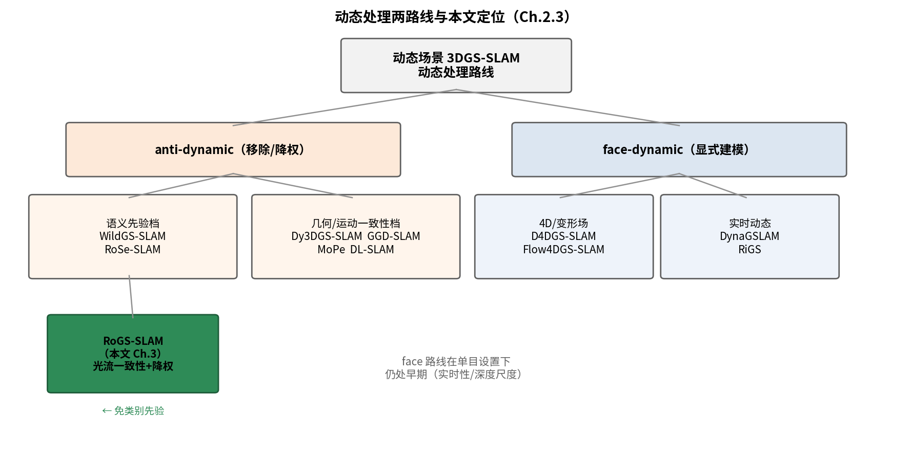

# 2.3 动态场景处理：anti-dynamic vs face-dynamic（综述草稿）

> 状态：开篇 + 分类框架。领域矩阵来自 monogs-ours/NOTES.md（40+ 篇，
> 2024-2026 调研），本文件把它们组织成综述正文，并逐篇补 bib。

动态场景 SLAM 的核心困难在于：刚性世界假设被打破——观测中同时存在
静态结构（可作为位姿约束）、动态物体（会污染约束）与二者边界的混合
像素。现有工作按对动态的处理哲学分为两大阵营。

## 2.3.1 anti-dynamic：动态即干扰

第一类方法将动态内容视为跟踪与建图的干扰源，核心操作是**识别并移除/降权**。
按所用信号可分为三档：

**语义先验档**。用预训练分割（Mask R-CNN [@maskrcnn2017]、SAM）或基础模型特征
（DINOv2）标记动态区域。WildGS-SLAM [@wildgsslam2025] 在 3DGS-SLAM 上引入
DINOv2 特征一致性 + 不确定性 MLP，在 Bonn 动态基准达到 2.31cm——但其
消融显示去掉视差正则化后退化到 10.97cm，说明即使是 SOTA 也依赖
Bonn 专用稳定器；且该类方法继承预训练模型的领域偏置与算力开销。
RoSe-SLAM [@roseslam2026] 将 2D 基础模型语义蒸馏进高斯基元。
这一档的精度上限高，但代价是把动态判断绑定在特定特征分布上：
我们复现时其在 Bonn 的成绩依赖视差正则化稳定器（消融去掉后
10.97cm），领域偏置并未消失，只是从类别标签转移到了特征空间。

**几何/运动一致性档**。不依赖语义标签，用多视图几何或运动一致性判别
动态。这一档的源头是残差式方法：ReFusion [@refusion2019] 以
surfel 残差在线判别动态，DynaSLAM [@dynaslam2018] 则把几何一致性
与语义掩码串联（几何先筛、语义兜底）。3DGS 时代该档分化为两条：
Dy3DGS-SLAM [@dy3dgsslam2025] 融合光流与深度不一致性构建动态掩码，
是首个纯 RGB 单目动态 3DGS SLAM；RoDyn-SLAM [@rodynslam2024] 在
NeRF 表示上融合光流与分割。GGD-SLAM [@ggdslam2026] 提出通用运动
模型免语义标注；DGS-SLAM [@gsydslam2024] 与 GARAD-SLAM [@garadslam2025]
同属该档的 3DGS 实现。MoPe [@mope2026] 以运动永续性 + SE(3) warping 的贝叶斯
后验驱动动态感知的高斯插入。这一档与本文路线最接近，区别在
时间观：MoPe 维护跨帧的运动后验，我们（Ch.3）只用当前帧与
上一帧的光流分歧——更弱的假设，换来对"停走停"物体的不同失效
方式。

**概率建模档**。DL-SLAM [@dlslam2026] 构建像素→物体级的双层概率表示，
在物体级做类别剪枝。物体级粒度是它优于像素级不确定性的地方
（边界干净），但也继承了实例分割的完整性依赖：漏检的物体
整个逃过剪枝。

本论文的研究内容一（RoGS-SLAM）属于几何/运动一致性档：以光流一致性
实现 mask-free 的动态判别，避免语义先验的领域偏置（详见 Chapter 3）。

## 2.3.2 face-dynamic：显式建模动态

第二类方法显式建模动态物体的运动（4D/变形场），将动态从"干扰"变为
"重建对象"。DynaGSLAM [@dynagslam2026]（WACV 2026）实现首个实时动态
GS-SLAM 并含运动预测；D4DGS-SLAM [@d4dgsslam2025] 是首个 4DGS-SLAM；
RiGS [@rigs2026] 用三类高基元（static/rigid/transient）加 scene flow
引导；Flow4DGS-SLAM [@flow4dgsslam2026] 以光流引导 4D 动态重建。
该路线在单目设置下仍属早期：实时性、深度尺度与长期一致性均未解决。

## 2.3.3 空缺与本文定位

综合两条路线的现状，可以提炼出单目动态 3DGS-SLAM 的三个结构性空缺：

**G1：语义先验依赖与几何判别的取舍**。anti-dynamic 阵营的高精度档
（WildGS-SLAM [@wildgsslam2025] 的 2.31cm）依赖 DINOv2 级预训练特征，
继承领域偏置与算力开销；免语义档（Dy3DGS-SLAM [@dy3dgsslam2025]、
GGD-SLAM [@ggdslam2026]）精度普遍落后一档。**不依赖语义先验又能达到
竞争精度的动态判别**仍是空缺——本文研究内容一（RoGS-SLAM）以光流
一致性填补该空缺（Chapter 3）。

**G3：动态内容的生命周期管理**。动态物体移除后留下的"幽灵"残影
（ghosting）是 3DGS-SLAM 特有病灶：高斯基元一旦被错误提交进静态地图，
后续帧缺乏删除机制。MoPe [@mope2026] 的运动永续性与 DL-SLAM
[@dlslam2026] 的类别化剪枝开始触及该问题，但均在离线或半在线设置下
验证。在线、增量、可回滚的高斯提交-撤销机制不完整——本文的
deferred_commit 三臂系统属于该方向（Chapter 3.3 节）。

**G5：逐帧跟踪的长期漂移**。现有动态处理（掩码、不确定性、4D 场）
全部作用于"每帧的观测质量"，而位姿估计仍以逐帧光度优化为主。当
动态干扰持续存在时，逐帧误差累积为全局漂移，且事后位姿图优化难以
恢复——短基线约束看不到漂移，长基线约束被动态污染。**跟踪循环
内部的在线窗口约束**（本文研究内容二，SWBA，Chapter 4）直接针对
该空缺；本文第 4 章将以 R1-R8 后处理实验的系统性失败证据说明为什么
该问题必须在跟踪内部解决。

（叙事衔接：G1 → Chapter 3（已收口）；G5 → Chapter 4（已收口，
部署终态 7.83cm）；G3 → Chapter 3 的 lineage（提交端，已收口）+ Chapter 5
（退出/恢复端，pilot 进行中——按预注册判据决定立项）。三个空缺
支撑三个研究内容的学硕结构；其中 G3 的后半是当前活跃战线。）

---
**TODO**：
- [ ] 逐篇补全 bib 条目（现 references.bib 10 条核心，目标 40+）
- [x] 2.3.3 空缺分析扩展（G1/G3/G5 → 三研究内容映射，2026-09-05）

图 2.3：anti/face-dynamic 两路线与本文定位。- [x] 分类图已渲染
