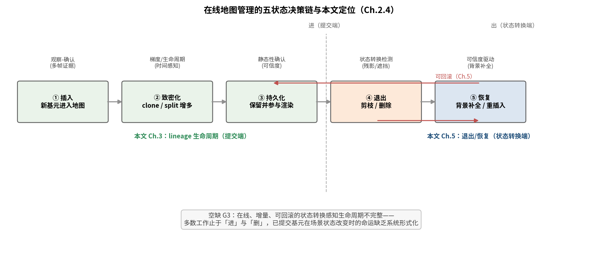

# 2.4 动态场景下的高斯表示与在线地图管理（综述草稿 v2）

> v2（2026-09-05）：按 Codex 建议从"致密化策略"改题——本节覆盖
> 插入、致密化、持久化、删除与场景状态转换的完整地图管理面，
> 使 Ch5 选题变化不必推翻本节。原 2.4 内容（致密化专述）并入 2.4.2。

在线 3DGS-SLAM 中，地图不是一次性重建的产物，而是随帧流的**增量
决策序列**：哪些基元进入（插入）、何时增多（致密化）、何时保留
（持久化）、何时退出（删除/剪枝）、以及场景状态改变时如何转换。
第二章 2.3 处理"观测端"（哪些像素可信），本节处理"表示端"——
动态场景的地图管理比静态场景多一个维度：**每个决策都要回答
"这个基元此刻还成立吗"**。

## 2.4.1 插入时机与观察-确认范式

基座（MonoGS）在每个关键帧立即提交全部新高斯。动态场景下立即提交
等于把瞬态内容烧进静态地图（RoGS 论文 Fig.3 的幽灵轨迹）。修正
范式的核心是**提交前观察**：RoGS-SLAM 的 lineage 生命周期
（Ch.3.6）与 RobustSplat [@robustsplat2025]（ICCV 2025）的
延迟致密化同属此思想——先积累多帧证据再决定基元去留。

动态内容的插入侧，face-dynamic 系（保留动态而非剔除）已形成两条
成型的在线机制线。其一为**条件式生命周期管理**：DynaGSLAM
[@dynagslam2026]（WACV 2026）将动态高斯的删除形式化为两条条件
（可观测性删除 Cond.1 与长寿命删除 Cond.2），并把定位外包给
DynaoSAM——动态基元从不回馈轨迹。其二为**自适应插入**：
Flow4DGS-SLAM [@flow4dgsslam2026]（CVPR 2026）用后向光流把当前
运动掩码回溯到上一关键帧、取差集确定"新出现的动态像素"
（M_insert），主张无需场景特定超参；其时序不透明度以 GMM 参数化
学习（软性淡出），但机制节无显式退役条件，动态基元只增不减的
长期行为未验证。两条线的共同点：插入或删除都依赖**外部信号**
（光流网络、语义分割器）或**显式条件式**（阈值/规则），尚无
把基元存在量交给优化损失本身仲裁的形式。

MoPe [@mope2026] 的运动永续性把观察-确认思想推到时间维度：动态
身份应随时间持续而非逐帧重判。

## 2.4.2 致密化策略（原 2.4 主体，压缩保留）

- 时间感知：TAD-GS [@tadgs2026]（ECCV 2026）VAD/TAT/TOW
  三元组——动态场景致密化标杆；Overfitting Analysis [@dynofa2026]
  诊断 split 致密化 >80% 过拟合贡献
- 前馈/替代：F4Splat [@f4splat2026] 前馈预测、EDGS
  [@edgs2025] 高质量初始化消除致密化、SplatMAP
  [@splatmap2025] SLAM 点云驱动、VAD-GS [@vadgs2025]
  体素可见性
- 我们的消融证据（21 run，详见 03_results/tables/）：动态场景
  **抑制致密化全错**（+25.6%/+29.1%），激进 clone ATE −29%——
  动态遮挡下静态支撑反而更稀疏，欠致密化与误致密化是双刃

## 2.4.3 已提交基元的退出、恢复与状态转换

大部分工作停在"进"与"删"，**已进入地图的基元在场景状态转换时的
命运**（物体移走后的残影清除、遮挡物消失后的背景补全、静态物
被搬动后的地图更新）是更完整的生命周期问题。~~DL-SLAM 与 MoPe
是仅有的触及者~~（2026-09-25 更正：该表述已被 CubifyGS 击穿）
——按占用复核（2026-09-20，全文级核对），**CubifyGS
[@cubifygs2026] 是本问题的最强近邻**：物体级"自由空间证据 →
显式剪除 → 补洞"（ray-cast 占用分析 + 时序衰减 + 事件触发 ROI
优化 + DINO 资产库复用），真实数据序列正是 Bonn box2（搬箱），
与我们 exit/carve 同一物理原理。但其为**物体级**（需检测器 +
资产库 + GT 位姿的纯建图框架，不报 ATE、定位收益列为 future
work）。修正后的差异面：DL-SLAM [@dlslam2026] 物体级类别剪枝、
MoPe [@mope2026] 高斯级后期清理、GARAD-SLAM [@garadslam2025]
以渲染惩罚替代硬剪除，构成物体级/基元级、anti/face 两极的
散点；**在线 RGB-D SLAM 环路内、无检测/无掩码/无资产库前提下的
基元级状态转换管理 + ATE 评测**仍无同型工作。此外 CubifyGS 的
剪除依赖显式占用阈值（存在概率 < τ_vanish），MoPe 依赖贝叶斯
后验门控——**生灭由优化损失梯度本身连续仲裁（无删除条件式）**
的形式在上述工作中均未出现。

【空缺 G3 的完整表述（2026-09-25 再更新）：状态转换感知的
生命周期管理，其"物体级/离线设定"已被 CubifyGS 占位；仍开放的
是三重交集——(i) 在线 SLAM 环路内（ATE 可判），(ii) 无检测器/
掩码先验/资产库，(iii) 基元级且退出与保留由同一优化目标连续
仲裁。这构成 Ch.5 的选题空间；exit 退出机制的立项 pilot
（2026-09-05：balloon2 2/2 配对胜基线 −5.7%）闭合了"退出端"
的第一步，正式研究（含 fill 保守化与残影直接指标）进行中。】

## 2.4.4 小结与本文的证据链

表示端管理 = 插入（Ch.3 lineage）→ 持久化（Ch.3 确认规则）→
状态转换（Ch.5 方向）。Ch.3 已收口前两者；Ch.5 承接第三者。

图 2.4：在线地图管理的五状态决策链（插入/致密化/持久化/退出/恢复）
与本文定位——Ch.3 覆盖提交端，Ch.5 覆盖状态转换端。

---
**TODO**：
- [x] 8 篇 bib 核实完成（2026-09-05）
- [x] 图：地图管理决策树（插入/致密化/持久化/退出/恢复五状态）——2026-09-14 完成（fig2_4_map_lifecycle.png）
- [x] 图：anti/face 分类图（原 2.3 遗留 TODO）→ 已确认为 fig2_3_taxonomy.png，登记于 2.3 节（图 2.3），非本节的重复项（2026-09-15 核对）
- [x] 2.4.1 补 face-dynamic 在线机制两线（DynaGSLAM 条件式 / Flow4DGS 自适应插入，bib 已有）
- [x] 2.4.3 "仅有触及者"表述更正（CubifyGS 占用复核击穿）+ cubifygs2026 入 bib（全文级核实，2026-09-25）
- [ ] MGS-SLAM（CVM 2026，significance-guided pruning，会场近邻）作者信息未获取（摘要级），
      定稿期补核实后决定是否入 2.4.3（当前不 cite）
- [ ] 图 2.4 更新：五状态链上加"生灭仲裁信号"维度（条件式 vs 损失梯度式）——待 Ch5 收口定型后画
