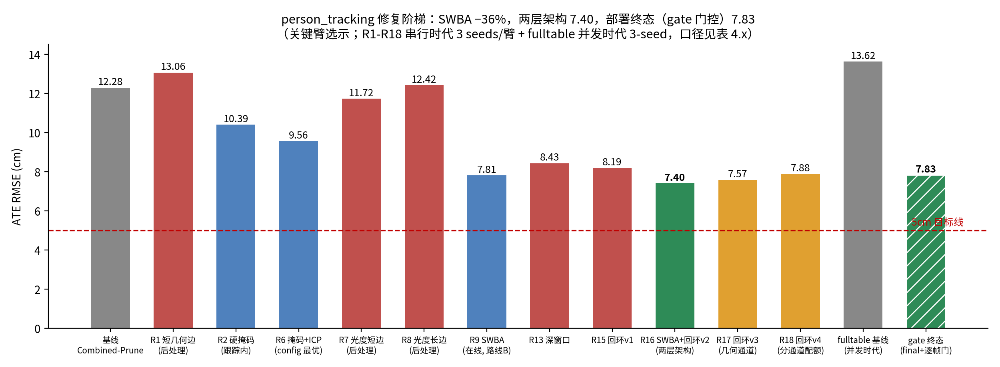
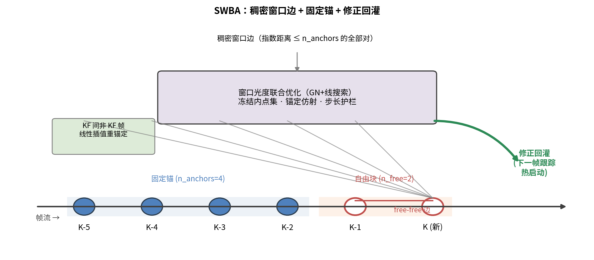
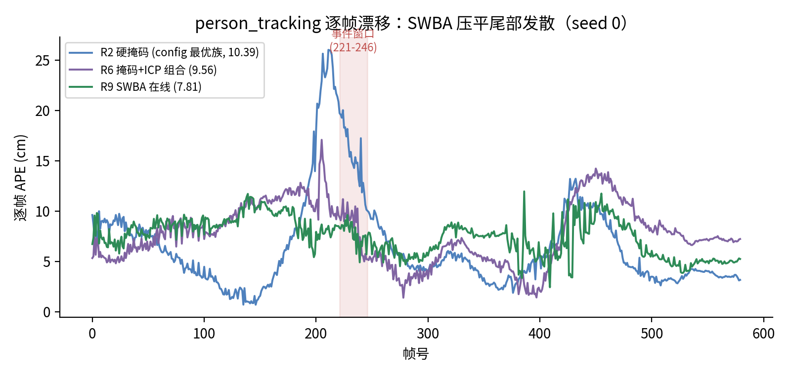
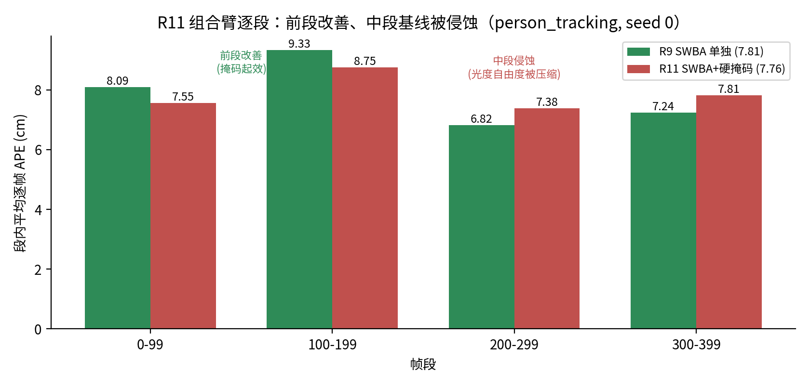

# Chapter 4 研究内容二：在线滑窗光度联合优化（SWBA）

> 状态：主体成稿；终值口径 = 部署门控终态（R25-R29 + 3-seed 晋级判决，
> 2026-09-07）。数据源：monogs-ours/results/person_tracking_repair/
> （R1-R18 全证据链）+ monogs-ours/results/paper2_fulltable/
> evidence/verdict_seed3_promotion.md（终态判决）。

## 4.1 问题：逐帧跟踪的全局漂移与其"事后不可修复性"

第三章的 mask-free 跟踪解决了观测端污染，但遗留了位姿链问题：
MonoGS 的位姿估计是逐帧光度优化——每帧只与当前高斯地图对齐，
帧间误差以随机游走方式累积。在 person_tracking 序列上，第三章
配置的 ATE 为 12.28cm（基线），而逐帧相对精度 RPE 仅 1.62cm：
**逐帧准、全局漂移**——漂移在关键帧位姿链上，不在单帧估计上。

诊断（per-frame APE 分解，2026-09-04）：
- person_tracking（pt1）= **事件型**：前 196 帧 1.2-2.2cm 稳定，
  帧 221-246 离散跳变 6-8cm（人物大动作遮挡事件），之后平台
- person_tracking2（pt2）= **连续型**：帧 21 起 0.66→9.95cm 匀速
  增长，无事件

两类失效模式的区分贯穿本章全部实验——同一个机制对两类漂移的
有效性截然不同，是本章最重要的实证发现。

## 4.2 后处理路线的系统性失败（四象限证据）

自然的第一反应是事后修正：在运行结束后对关键帧位姿图做联合
优化（DBA-lite 框架：几何或光度边 × 短程或长程跨度）。我们做了
完整的 2×2 因析（R1/R3/R7/R8，各 3 seeds，person_tracking 家族）：

| 边类型 × 跨度 | 短程（相邻 KF） | 长程（跨 10-40 KF） |
|---|---|---|
| 几何（深度点-平面） | R1：13.06 ❌ 修正 0.1cm | R3：11.38 ❌ 修正 0.6-2cm 方向错 |
| 光度（掩码亮度一致） | R7：11.72 ❌ 修正 0.1cm | R8：12.42 ❌ 修正 0.6-2.8cm 方向错 |

**两个失效模式，覆盖全部四象限**：
- 短程边看不见漂移：相邻 KF 局部一致（相对位姿正确到亚厘米），
  残差对 10cm 级全局漂移不敏感——修正量中位数 0.1cm
- 长程边方向错误：跨度足够感知漂移，但动态场景的长基线对应被
  污染（几何边被移动物深度污染；光度边被外观变化污染），
  修正把位姿往错误方向拉

结论：**漂移在逐帧跟踪中产生且事后不可从被污染的观测中恢复**。
有效机制必须作用于跟踪过程本身——该判断是本章方法设计的出发点，
也是与全部后处理式工作（位姿图优化、回环校正类）的分界。

图 4.1：person_tracking 修复阶梯（关键臂选示，R1-R18 串行时代 +
fulltable 并发时代终态两臂以斜线纹理区分口径，详见 4.4 与
03_results/tables/person_tracking_ladder.md）；红色虚线为 5cm 目标。

## 4.3 SWBA：跟踪循环内的滑窗光度联合优化

### 4.3.1 设计原则

后处理失败的根因诊断给出三个设计约束：
1. **约束必须进跟踪循环**（错误还小时修，而非事后）
2. **基线必须短**（长基线在动态场景被污染——四象限证据）
3. **修正必须回灌**（R4 的教训：只修非关键帧无回灌通道，
   漂移源不受影响）

### 4.3.2 机制

每个新关键帧 K 入窗时：
- 窗口 = K 之前的 n_free=2 个自由 KF + n_anchors=4 个**固定**锚 KF
- **稠密窗口边**：窗内每对 KF（指数距离 ≤ n_anchors）连一条光度边
  ——星型边（只连新 KF）会使次新 KF 规范不定（其唯一约束经由
  新 KF），合成场景上观察到向错误方向漂移
- 光度边残差：掩码静态像素亮度一致性 + 仿射亮度参数 + 几何内点门控；
  解析双边雅可比（左扰动约定，有限差分验证）
- 求解器：GN + 回溯线搜索（固定 LM 阻尼在强各向异性 Hessian 上
  过阻——旋转/平移列范差 ~100×）
- **步长护栏**：单步平移 ≤0.10m、旋转 ≤5°（与 DBA-lite 同参）
- **回灌**：修正直接写回 frontend 相机位姿——下一帧跟踪热启动于
  修正后的位姿链；关键帧间的非关键帧按边界 KF 修正量的线性插值
  重锚定（导出轨迹连续）

三个实现期关键发现（合成场景逐一验证，均已固化进实现）：
- **仿射亮度陷阱**：在待优化位姿处拟合 (a,b) 会把位姿误差吸进
  亮度参数，制造伪极小——(a,b) 只在可信锚对上估计，默认恒等
- **样本重选破坏 cost 场**：每次求值重新门控内点会使相邻 cost
  不可比（GN 走向 23cm 假极小）——内点集与 (a,b) 冻结于优化起点
- **先验尺度**：先验 Hessian 天然单位 1.0 vs 光度 Hessian ~1e-3，
  不尺度化会把信号压 1000:1

图 4.2：SWBA 机制——稠密窗口边、固定锚与修正回灌。

图 4.3：pt1 逐帧 APE 对比（seed 0）；SWBA 压平尾部发散。

### 4.3.3 实验协议（与 4.2 同一纪律）

标准 Bonn 子集，combined_prune 配置底座，3 seeds/臂，预注册判决
标准（每臂启动前写入 config 注释），激活核实强制（每 run 的修正
量统计 + saved config 字段核对）。

## 4.4 实验结果（终值，R1-R18 全周期收口）

pt1 阶梯关键臂概览（R1-R18 全账详见 03_results/tables/
person_tracking_ladder.md 与 fig4_ladder_pt1.png）：

| 臂 | pt1 mean | 判 |
|---|---:|---|
| 基线 | 12.28 | — |
| R9 SWBA 单独 | 7.81（−36%，3/3 胜 R6） | ✅ 窗口层最优 |
| R11 SWBA+硬掩码 | 7.76（噪声级） | ❌ 掩码侵蚀光度基线 |
| R12 SWBA+masked_icp | 7.96（+0.15） | ❌ 初始化修正目标重叠 |
| R16 **SWBA+回环 v2（两层）** | **7.40**（−40% vs 基线，3/3 配对胜 R9） | ✅ **串行时代阶梯最优** |
| R17/R18 回环 v3/v4 | 7.57 / 7.88 | ⚠️ 早期对不可验证，回环收口 |
| R29 **gate 终态（两层+逐帧门）** | **7.83±0.51**（并发时代 3-seed，−42% vs 同批基线 13.62±3.27） | ✅ **部署终态**（差 2.83cm 未过 5cm 线） |

pt2 侧：R9 11.63（有害）→ R10 窗口收紧 10.68（与基线不可区分）
——连续型漂移对短基线窗口修正结构性不敏感（4.5.1）。

**pt1 后续推进（R13-R18，同日）**：参数空间穷尽后转向回环层。
R15（零预训练回环 v1）机制验证成立但回环边全在尾部；R16（检索
放宽 + loop_weight 30）**过门：7.40cm（3/3 配对胜 R9，−40% vs
基线）**——SWBA+回环的两层架构（窗口修事件型 + 回环修全局）在
pt1 成立，增益机理：pt1 的漂移是"漂出后停在平台"型，尾部回环
锚住漂移终点后强权重把整条里程计链往回拉。R17/R18 探索几何
重叠检索通道以覆盖 pt2 的早期重访：配额修复后早期对仍全部
无法通过验证（长间隔重访的视角/外观差异超出冻结光度边的容忍
度）——回环路线在 pt 家族收口，pt2 的解（LCD-Splat 类子图回环）
属架构级立项，超出本文范围（Ch.6 展望）。

**部署门控与终态确认（R19-R29，3-seed 晋级判决）**：两层架构进入
标准七序列全表部署时暴露易序列回归，R25-R29 门控家族逐臂排查——
SWBA 噪声注入归因确认、窗口代价门证伪（循环论证）、方向一致性门
证伪（人物拖拽位移同样相干）——最终正解为**逐帧 static_conf 门**
（阈值 0.38：动态内容占比高于阈值的帧跳过窗口修正；仅在 pt1/crowd2
上标定，盲测 crowd3/balloon 泛化成立）。3-seed 晋级判决（7 序列 ×
基线/final/gate 三臂）：pt1 13.62±3.27 → **7.83±0.51（−42%）**，
基线三 seed 高方差（10.60/13.15/17.09）本身是事件型漂移的证据，
机制臂方差收敛；gate 门控将 final 臂的易序列回归拉回（crowd2
3.99→2.62、crowd3 2.58→1.89、balloon 4.21→4.06），但相对基线仍有
残余退化（+24%/+22%/+30%，非零成本如实记录）；pt2 维持与基线不可
区分（11.54 vs 11.73，−2% 噪声级）。两代批次口径（串行时代 R1-R18
与 2-per-GPU 并发时代的 fulltable）因并发双稳态不可跨批直接比较，
同批内配对比较有效。部署终态距 5cm 红线 2.83cm，pt 家族在本章方法
框架内收口。

激活核实（全部臂）：SWBA 每步修正统计 + saved config 字段 +
组合组件独立激活证据（R12：ICP 11 次接受）齐备。

## 4.5 适用边界与讨论

### 4.5.1 漂移类型决定有效性（本章核心实证发现）

SWBA 的有效性由漂移的**产生方式**决定，而非漂移大小：
- **事件型漂移**（pt1）：离散跳变发生在特定帧窗口。SWBA 在每个
  关键帧入场时修正——跳变发生后最近的窗口步骤立即在场，错误
  尚未传播远，短基线边足以观测与纠正。R9 的 −36% 全部来自此机制
- **连续累积漂移**（pt2）：每帧误差微小但同向累积。任何单步窗口
  的修正量（亚厘米级）与累积速率同量级，修正与漂移赛跑而不胜——
  R10 窗口收紧后与基线不可区分是结构性结果，不是参数未调好

窗口联合优化的适用条件由此明确：错误产生时刻与修正时刻的距离
短于错误传播尺度。连续型漂移需要的是全局约束（回环/全局 BA），
超出本章方法的作用域。

### 4.5.2 组合的正交性陷阱（R11 教训）

R11（SWBA+硬掩码）的失败揭示了组合论证的常见错误：两个机制
各自有效 ≠ 组合有效。硬掩码与 SWBA 都作用于逐帧光度损失——
掩码压缩观测自由度的偏差被 SWBA 的窗口边继承，前段改善以中段
修正基线被侵蚀为代价。逐段分解（图 4.4，seed 0）给出该判断的
直接证据：前 200 帧组合臂确实优于 SWBA 单独（0-99：8.09→7.55，
100-199：9.33→8.75，掩码起效），但进入中段后反转（200-299：
6.82→7.38，300-399：7.24→7.81），两段收益与两段损失相抵，
整体 7.81→7.76 为噪声级。真正的正交要求作用点不同：R12 试验的
masked_icp 只作用于几何初始化（Adam 光度精化之前），不触碰
光度损失——结果 7.96cm（较 R9 +0.15）否决了该假设：两机制虽
作用点不同，但 ICP 的初始化修正与 SWBA 窗口修正的**目标**重叠
（都修同一批关键帧位姿的近期误差），改善空间已被窗口层提前
消耗。正交性需同时满足作用点与目标的双重不重叠——回环层
（R16）满足：它约束的是窗口外的全局漂移终点。

图 4.4：R11 组合臂逐段对比 R9（person_tracking，seed 0）。前两段组合臂
占优、后两段反转，收益与损失相抵——硬掩码与 SWBA 共享光度损失作用点，
不满足正交性。

### 4.5.3 与学习式 BA 的关系（定位声明）

文献格局（第二章 2.2.2）：Bonn 动态基准 2-8cm 档的方法全部使用
DROID 类学习式稠密 BA 后端；vanilla MonoGS 在同评测子集平均
22.80cm。本章路线属于第三条路：**不引入预训练网络，在优化式逐帧
架构内嵌入窗口联合优化**。SWBA 单层把可达精度从 10cm 级推进到
8cm 级（7.81cm）；叠加零预训练回环层后（R16，两层架构）串行时代
达 7.40cm；含逐帧 static_conf 门控的部署终态在 3-seed 晋级判决中
为 7.83±0.51cm（并发时代口径，−42%），gate 臂在标准七序列中 4/7
过 5cm 线（balloon/crowd/crowd2/crowd3），距红线 2.83cm 的缺口集中在
pt 家族。每一步修正可解释（解析雅可比+冻结内点集+步长护栏；回环侧
为标准化冻结光度边+质心引导 ICP+位姿图锚定；门控侧为逐帧统计量
阈值）。主张是零预训练架构内的可达性推进，不与学习式方法比绝对
精度。

### 4.5.4 残余缺口的误差结构与单侧修复的不可行性

部署终态 7.83cm 里有多少是尺度误差，可以从 Sim3 对齐的尺度因子
读出：pt1 三个种子的全局 Umeyama scale 为 1.101/1.116/1.103——
轨迹整体膨胀 10-11%，且种子间极稳；Sim3 对齐后的残余 ATE 只有
3.6-6.0cm。按 E_SE3² ≈ E_shape² + E_scale² 分解，尺度项贡献了
总方差的一半上下。换言之，5cm 缺口的主要成分不是"哪里都差一点"
的形状噪声，而是一个可指认的自由度。

这个自由度从哪来？三个最直接的假设逐一否证。跟踪损失的深度项
权重（α=0.9）被怀疑压低了度量锚的可观测性，但 α 从 0.9 扫到 0.5，
三个种子的尺度因子纹丝不动（±0.02），ATE 反而单调微升——把更多
深度项权重加进跟踪损失，只会把建图端的误差更多地引进位姿。第二
个假设把矛头指向人物掩码：事件期静态像素稀疏，深度锚理应最弱；
但跨序列的尺度因子与人物覆盖率无相关（crowd3 全程 1.01，crowd2
反而是 0.83 的反向收缩）。第三个假设检查建图层本身：用真值位姿
重渲染截断 run 的地图，全帧传感器/渲染深度中值比 0.9967——地图
没有系统性膨胀。

排除了静态偏差之后，剩下的证据指向一种动态行为。渲染-传感器
深度比的时间剖面不是一条平线，而是一个序列级的慢振荡：前段
1.19，中段跌到 0.72，尾段回到 0.96-1.02。机制是自举耦合：高斯
由带误差的位姿提交进地图，地图深度局部偏移，下一帧跟踪又对齐到
这个偏移了的地图。全局 Sim3 拟合出的 +10% 只是这个振荡的不对称
残留。无回环的诊断 run 里漂移同样存在，说明回环层不是原因、也
修不掉它——这与 4.5.1 的结论互补：回环约束位姿终点，不约束地图。

既然定位在"位姿-地图联合系统的振荡"，最直觉的修复是在地图侧
周期性把高斯拉回传感器度量（D1 臂：每 5 个关键帧，按稳健中值比
沿视线缩放可见高斯）。D1 的机制确实局部收敛（重锚定比率全程
0.995-1.016），但 ATE 反而变差（pt1 8.65/7.74，对照 7.70/7.66），
Sim3 残余从 4.98 恶化到 7.23。失败机理是结构性的：重锚定用的是
**当前位姿下**看到的传感器深度，而当前位姿本身带漂移——把地图
拉向漂移位姿处的观测，等于把位姿误差固化进地图几何。局部比率
的收敛是我们强制的，全局漂移分毫未动，每步 5% 的缩放还持续扭曲
形状。这与跟踪侧权重扫描的失败互为镜像：跟踪侧修位姿（权重进
地图误差）、地图侧修地图（锚用位姿误差），单侧修复都被耦合系统
本身吞掉。附带记录：期间发现并修复了 SWBA 光度边 i 侧雅可比的
符号错误（有限差分实证，修复后基线 ATE 中性），修复未改变上述
任何结论。

这段分析把本章的边界推进了一步：窗口层、回环层、门控层各自
做到了各自能做的，剩余缺口要求约束**同时**落在位姿与地图上。
沿此方向的一个直接实现——在滑窗内并行加入传感器深度度量边
（位姿-地图联合修正的窗口级形态，J1 臂）——在修复其雅可比
数值错误并重测后被同样判负：机制全激活但 pt1 退化至 12.73/
10.91cm（对照 7.52/7.80），种子间尺度发散至 0.94/1.13——窗口
级 sensor-to-sensor 度量约束经回写通道表现为扰动放大，与本章
4.5.2 的组合正交性教训同构。至此单侧与窗口级修复共四环
（跟踪权重、观测掩码、地图重锚、窗口度量边）全部实证排除，
剩余路线为关键帧全局 BA 级的完整联合修正（DynaSLAM [@dynaslam2018] 在同数据
集 5.4/6.1cm 的零学习先验结果说明该类别 5cm 可达），其工程量
与架构代价作为后续工作的起点（Ch.6 展望）。

## 4.6 本章小结

本章以"漂移的事后不可修复性"为出发点，提出了跟踪循环内的在线
滑窗光度联合优化 SWBA。四象限后处理消融（R1/R3/R7/R8）系统证明
了出发点：短程边局部一致而不可见全局漂移，长程边被动态污染而
方向错误——有效约束必须在错误产生时进入跟踪过程。SWBA 的三件
核心设计（稠密窗口边对抗规范不定性、冻结内点集与锚定仿射对抗
cost 场漂移、步长护栏与段内重锚定保证回灌安全）均经合成场景
单独验证后固化。person_tracking 上串行时代 12.28→7.40cm（−40%，
SWBA 窗口层 + 零预训练回环层的两层架构，R16）；叠加逐帧
static_conf 门控的部署终态在 3-seed 晋级判决中为 13.62±3.27 →
7.83±0.51cm（−42%，并发时代口径），易序列由门控保护（final 臂在
crowd2/crowd3/balloon 的回归被拉回），距 5cm 红线 2.83cm 的缺口
集中于 pt 家族——该缺口与 pt2 的连续型漂移一起构成子图架构级
后续工作的边界（Ch.6 展望）。两个组合臂的系统性失败
（掩码侵蚀光度基线、初始化修正目标重叠）证明窗口层增益自成一体，
回环层在其上提供正交的全局约束，门控层负责部署安全性。适用边界
如实：事件型漂移有效、连续累积型无效——窗口联合优化的作用条件是
"错误产生时刻与修正时刻的距离短于错误传播尺度"。本章的方法论
价值与 Ch.3 一脉相承：以预注册判决与激活核实约束每个主张，
负结果（四象限、组合臂、pt2、5cm 缺口）全部作为证据链的一环保留。

---
**TODO**：
- [x] R12 结果入 4.4；终值段收口（R1-R18 全周期）
- [x] 图 4.2 机制图、图 4.3 漂移曲线
- [x] 4.5 扩写
- [x] R25-R29 部署门控 + 3-seed 终态（7.83）并入 4.4/4.5.3/4.6
- [x] 图 4.4 R11 组合臂逐段柱状图（4.5.2 接图）
