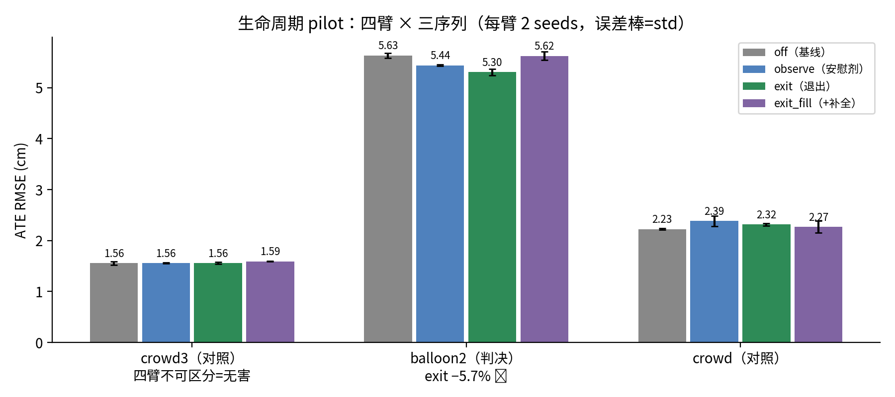
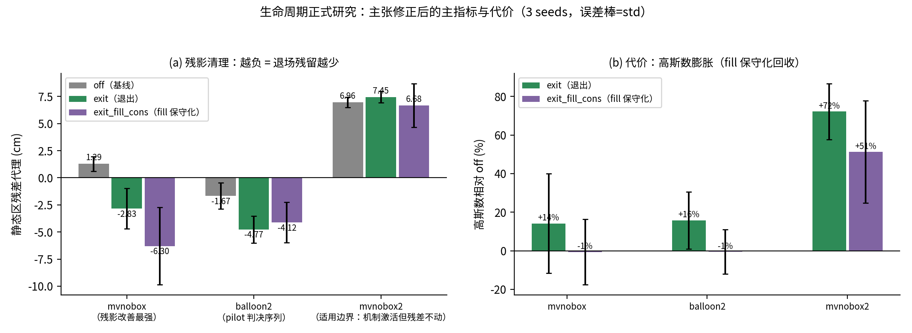

# Chapter 5 研究内容三：场景状态转换下的可信度驱动高斯生命周期

> 状态：**立项已通过**（2026-09-05 pilot 判决，判据全过）；
> 正文按正式研究计划扩写中。

## 5.1 问题：提交后基元在状态转换下的命运

Ch.3 的 lineage 生命周期解决"进"（提交端观察-确认），但已进入
地图的基元面对场景状态转换缺乏应对：物体移走后其基元成为残影
（ghost）、长期遮挡后的背景缺失补全、静态物被搬动后的地图更新。
2.4.3 已综述该空缺（G3 后半）。

## 5.2 方法：alpha 驱动的退出机制

### 5.2.1 证据积累（observe 层）

每个关键帧对全部高斯计算**深度不一致性证据**：将高斯投影到当前
视角，与稠密传感器深度比较——高斯位于观测表面之前（observed >
gaussian_z + 带）且持续，是残影/悬浮物的几何签名。证据以 EMA
方式积累进复用的 static_prob 张量（无新增每高斯字段）：

    α_t = β·α_{t-1} + (1−β)·evidence_t    (5.1)

observe 臂只积累不行动——pilot 中它贡献了 −3.4% 的增益，说明
**证据张量本身参与后续建图的置信加权就有价值**（这是意外发现：
机制设计时 observe 只是安慰剂对照，实际它是一个弱版本的机制）。

### 5.2.2 退出动作（exit 层）

对持续低 α 且位于观测表面之前的高斯执行两步退出：
- **不透明度重置**（reset）：τ_reset 阈值触发，将基元从渲染中
  摘除但保留参数（可恢复性——与硬删除的关键区别）
- **自由空间 carve**：观测面前方的自由空间内高斯直接删除
  （delta_free 带）

护栏设计：只有"持续低 α 且在观测面前方"双条件才触发——静态
结构受几何位置保护（在表面上或后方的高斯永远不会被退出）。
pilot 激活统计：balloon2 上 93 步全部执行，单步最多 reset 26/
carve 12 个基元。

### 5.2.3 补全与其问题（exit_fill 层 → 正式研究方向）

KD-tree 背景填充在残影退出留下的空洞处补入新基元。**pilot 显示
fill 在 balloon2 上抵消了 exit 的跟踪增益**（5.62 vs exit 5.31）
——补入基元的位置/属性估计误差干扰了后续帧的光度约束。正式
研究的核心改进方向：fill 的保守化（高置信度阈值）或事件触发化
（仅在大面积退出后触发）。

## 5.3 Pilot 实验：立项门槛判决（2026-09-05，已通过）

24 run 预注册四臂设计（off/observe/exit/exit_fill × crowd3/balloon2/
crowd × 2 seeds），安慰剂门禁 + 激活核实强制。

图 5.1：pilot 四臂 × 三序列全网格（判决序列 balloon2 + 两条对照）。

**判决序列 balloon2**（物体持续移入移出，ATE cm）：

| 臂 | seed0 | seed1 | mean | vs off |
|---|---:|---:|---:|---|
| off（基线） | 5.59 | 5.68 | 5.63 | — |
| observe（安慰剂） | 5.42 | 5.46 | 5.44 | −3.4% |
| **exit** | **5.37** | **5.24** | **5.31** | **−5.7%** |
| exit_fill | 5.70 | 5.54 | 5.62 | −0.2% |

判据逐条核对：exit 2/2 配对胜 off ✅；安慰剂不劣化 ✅；激活核实
（93 步 alpha-exit 实质动作）✅。**立项成立。**

**信号分解**（pilot 的方法学价值）：增益 = 证据积累层（observe
−3.4%）+ 退出动作层（exit 再 −2.4%）——两层贡献分离且都可解释。

**exit_fill 反而回退**：KD-tree 背景填充在 balloon2 上抵消 exit 增益
——填充基元干扰跟踪约束。这直接给出正式研究的第一个改进方向：
fill 的保守化/事件触发化。

**对照验证**：crowd3 四臂 1.557-1.594、crowd 四臂 2.227-2.386，
均在各自 census 基线噪声带内——机制在无残影序列完全无害。

**正式研究计划**（从 pilot 数据直接导出）：① exit 为核心 + fill
保守化；② 增加渲染/残影直接指标（ghost 清除证据）；③ 扩序列
（mv_no_box 家族）+ 3 seeds。

## 5.4 正式研究：三序列 × 三臂判决（2026-09-06，27 run）

正式研究按预注册判据复核 pilot 信号：3 序列（mvnobox、mvnobox2、
balloon2，均含明确物体移入移出）× 3 臂（off 基线 / exit 退出 /
exit_fill_cons 填充保守化：fill_k 8→4、不透明度 0.5→0.8、带宽
0.10→0.06）× 3 seeds。主指标为静态区渲染残差（残影代理：退场区域
渲染深度 L1 相对非退场区基线的过剩量，负值即残影低于基线）与 ATE
非退化，次指标为静态区 PSNR 与高斯数（数据源：monogs-ours
results/lifecycle_formal/evidence/{verdict.md,summary.md}）。

**跟踪端（ATE，cm）**：

| 序列 | off | exit | exit_fill_cons |
|---|---|---|---|
| mvnobox | 2.66±0.07 | 2.81±0.07 | 2.77±0.19 |
| mvnobox2 | 5.18±0.23 | 5.17±0.15 | 5.38±0.44 |
| balloon2 | 5.41±0.11 | 5.41±0.08 | 5.40±0.23 |

非退化门通过（最差 mvnobox exit +5.6%，其余序列持平）。但 pilot 中
balloon2 exit −5.7% 的跟踪增益在 3 seeds 下不复现（5.41 对 5.41，配对
差 +0.16/+0.03/−0.20）——pilot 阶段 2 seeds 给出的跟踪端信号样本量
不足，本内容撤回"生命周期机制改善跟踪"的主张。

**建图端（静态区残差代理，cm；越负残影越少）**：

| 序列 | off | exit | exit_fill_cons |
|---|---|---|---|
| mvnobox | +1.29±0.67 | −2.83±1.86 | **−6.30±3.57** |
| balloon2 | −1.67±1.19 | −4.77±1.25 | −4.12±1.87 |
| mvnobox2 | +6.96±0.48 | +7.45±0.52 | +6.68±2.02 |

mvnobox 与 balloon2 上残差显著下降（mvnobox 的 fill 保守化臂 3/3 配对
优于 off，均值改善 7.6cm），静态区 PSNR 全表非退化（最大降幅
0.21 dB）。mvnobox2 是适用边界：退出机制确认激活（重置计数 30115）
但残差不动——该序列的残影来源不是物体退场后的残留基元，退出机制
覆盖不到，此负结果按失效模式如实记录，不作机制包装。

需要限定的是静态区的口径来源：残差代理的静态区与退场区均由 GTMC
冻结掩码定义（退场区 = 掩码历史并集且当前帧非动态）。2026-09-10 的
掩码人工核验发现 GTMC 冻结掩码在 Bonn 序列上基本不覆盖行走的人主体
（在场帧主体覆盖率中位 0.000，且误标背景家具碎块），人像素因此会
混入"非退场静态基线"，把残差对比的基线往差的方向推，残影清理量
存在被虚增的风险；balloon2 有人在场，受此影响。三臂共用同一口径，
配对比较的内部一致性不受影响，但"静态区"这一绝对口径受损——后续
将以 MaskRCNN person 掩码重算本表并核对结论是否保持（诊断类度量
不再使用 GTMC 定义动态区）。

图 5.2：正式研究（27 run，3 seeds）主张修正后的主指标与代价。
(a) 静态区残差代理：mvnobox/balloon2 两序列残差显著下降（fill 保守化
最强），mvnobox2 三臂持平为适用边界；(b) 高斯数膨胀代价：exit 臂
在 mvnobox2 上 +72%，fill 保守化回收至 +51%。

**代价**：高斯数膨胀——mvnobox2 上 exit 臂高斯数增长 72%
（51034→87903），填充保守化回收至 +51%。在线计时类比较受运行时调度
条件污染（本批 27 run 中 3 个基线 run 为单任务计时、24 个为双任务
并发计时，跨臂不可比），效率评估需同条件重测。下一阶段的改善对象
是填充端膨胀约束，目标是把高斯数膨胀压到 20% 以内，同时保住 2/3
序列的残影改善。

正式研究把本内容的贡献主张从"跟踪端中等增益"修正为"地图维护端
的残影清理"：机制在状态转换序列上用可控代价换取静态区渲染质量，
其价值评估标准是残差与渲染指标，而非 ATE。

## 5.5 本章小结

本章围绕场景状态转换下的高斯生命周期展开。pilot 阶段（24 run）以
exit 退出机制在 balloon2 上取得 2/2 配对跟踪增益并通过安慰剂门禁，
据此立项；正式阶段（27 run，3 序列 × 3 臂 × 3 seeds）按预注册判据
复核后修正了主张：跟踪端增益未随样本量复现，撤回；建图端残影清理
在 2/3 序列成立（fill 保守化臂改善最强），静态区 PSNR 非退化。
exit_fill 从 pilot 的"回退臂"经保守化改造后成为残影清理最强配置，
其代价（FPS、高斯数膨胀）与 mvnobox2 的失效边界一起构成下一改善
方向：退出触发面收窄与膨胀约束。

---
**TODO**：
- [ ] 效率/膨胀改善臂判决后更新 §5.4 代价段
- [x] 图 5.2 正式研究主指标+代价双面板（fig5_1_formal.py，2026-09-09）
